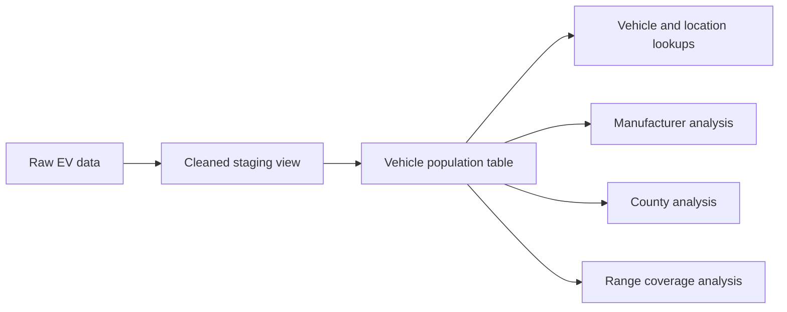

# Washington EV Market Analysis with BigQuery

An SQL and cloud data warehousing project exploring nearly **300,000 electric vehicles** in Washington's vehicle registration dataset. I used Google BigQuery to organize the data, check its accuracy, and analyze where EVs are concentrated and how manufacturer share varies by model year.

**Tools:** Google BigQuery · GoogleSQL · Git

## What I wanted to understand

- Which manufacturers account for the largest share of EVs across model years?
- Which Washington counties have the most EVs?
- How common are fully electric vehicles compared with plug-in hybrids?
- How can the data be structured to support reliable, efficient analysis?

## Key findings

The dataset contains **299,705 vehicles**, including **298,916 located in Washington**. The findings below use the Washington records.

| Finding | Result |
|---|---|
| EVs are concentrated in King County | 144,257 vehicles — **48.26%** of the Washington total |
| Fully electric vehicles dominate the mix | **80.67%** are battery electric vehicles; the rest are plug-in hybrids |
| Tesla has a smaller share among newer model years | **56.03%** of model-year 2020 vehicles versus **26.37%** of model-year 2025 vehicles |
| Range information is often missing | **65.49%** have no positive reported range, making coverage important when comparing averages |

Model-year comparisons describe vehicles in this dataset snapshot, rather than annual sales. [Read the full analysis →](docs/findings.md)

## What I built

I organized the data into a vehicle population table, two lookup tables for vehicle configurations and locations, and three reusable reporting views.

The SQL standardizes names, handles missing range values, calculates manufacturer shares with window functions, and ranks manufacturers within each model year.

### Making the counts reliable

During validation, I found that the original fact table contained **713,043 rows for only 299,705 vehicles**. Nonunique location keys allowed vehicles to match multiple location records.

I rebuilt the model with keys based on the complete location attributes and added **six SQL checks** for unique IDs, unique lookup keys, and consistent row counts. The corrected table contains one row per vehicle, including after joining both lookup tables.

### Reducing query scans

I partitioned the vehicle table by model year and clustered it by state, county, and manufacturer. For a query covering King County vehicles from model years 2021–2024:

| Query source | Data scanned |
|---|---:|
| Original staging view | 10.05 MB |
| Partitioned vehicle table | 4.19 MB |

That is approximately **58% less data scanned** in the observed run. This is a scan-volume comparison, not a measured reduction in billing or execution time. [Benchmark details →](docs/performance.md)

## Explore the project

| File | Purpose |
|---|---|
| [Audit SQL](sql/00_audit_existing.sql) | Check the original tables for duplicate IDs and inflated counts |
| [Warehouse build](sql/01_build.sql) | Create the tables and reporting views, and run integrity checks |
| [Analysis queries](sql/02_analysis.sql) | Explore manufacturers, counties, range coverage, and utility labels |
| [Benchmark queries](sql/03_benchmark.sql) | Compare scans through the staging view and partitioned table |
| [Benchmark validation](sql/04_validate_benchmark.sql) | Compare the two benchmark result sets |
| [Results](results/) | View aggregate findings as CSV and JSON |

## Running the SQL

1. In BigQuery, choose your project and use the `US` processing location.
2. Provide the cleaned input view as `raw_ev.stg_ev_population`, following the [source schema](docs/data_contract.md). The build scripts use this existing staging view as their starting point.
3. Run `sql/01_build.sql` to create the warehouse and execute its six validation checks.
4. Run individual queries from `sql/02_analysis.sql` to explore the results.
5. Use `sql/03_benchmark.sql` and `sql/04_validate_benchmark.sql` to reproduce the scan comparison and check result equality.

## Data source

[Electric Vehicle Population Data — Washington State Department of Licensing](https://data.wa.gov/Transportation/Electric-Vehicle-Population-Data/f6w7-q2d2)

This project analyzes an uploaded snapshot of the dataset. Raw vehicle-level records are not included in the repository. Additional modeling assumptions and data limitations are documented in the [data contract](docs/data_contract.md).
