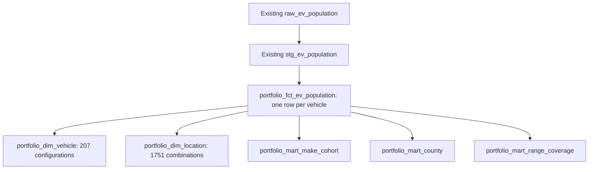

# Washington EV Population Warehouse

A Google BigQuery analytics engineering project that turns an existing EV population dataset into a tested warehouse and three reporting views. It fixes a concrete reporting defect: the old fact table contained 713,043 rows for 299,705 unique vehicles. The corrected model preserves one row per vehicle.

**Stack:** Google BigQuery · GoogleSQL · dimensional modeling · SQL assertions · partitioning and clustering

**Highlights:** 299,705 vehicles modeled · 413,338 excess fact rows eliminated · six integrity checks passed · three analytical views deployed

## Query scan comparison

A King County query covering model years 2021–2024 scanned **10.05 MB through the staging view versus 4.19 MB through the partitioned fact table**, approximately **58.3% less data scanned** in the observed run. This measures scan volume, not billing or latency savings. See [benchmark methodology and limitations](docs/performance.md).

## What this project answers

1. How does manufacturer share differ across model-year cohorts?
2. Where are Washington's registered EVs concentrated, and how does the BEV/PHEV mix vary?
3. How complete is reported electric range, and when would averages be misleading?
4. Can a partitioned reporting table reduce the data scanned for a common analytical query?

## Verified results

| Measure | Result |
|---|---:|
| Vehicles in source and corrected fact table | 299,705 |
| Vehicles with state = WA | 298,916 |
| Vehicle configurations | 207 |
| Distinct location/utility combinations | 1,751 |
| BEV share of Washington EVs | 80.67% |
| Washington vehicles with unknown cleaned range | 65.49% |
| King County share of Washington EVs | 48.26% |
| Tesla share of 2020 model-year cohort | 56.03% |
| Tesla share of 2025 model-year cohort | 26.37% |

These are results from the uploaded snapshot, not live statewide totals. The snapshot's original extraction date has not been established. Model year is a vehicle attribute, not a purchase or registration date. The Tesla comparison therefore describes the composition of vehicles still in this snapshot; it does not measure annual sales or establish why the mix changed.

## Architecture



The fact table retains frequently queried attributes as well as dimension keys. This intentional denormalization supports direct BigQuery reporting. Dimensions are extracted from the same normalized rows, and their keys include every attribute at the dimension's grain. JSON serialization distinguishes nulls and field boundaries before SHA256 hashing.

The previous location dimension had 1,751 rows but only 1,267 distinct keys. A location key based on only ZIP/county cannot uniquely identify rows also distinguished by city, state, and utility. The corrected model constructs keys from the full location tuple and avoids joins during fact construction. Six SQL assertions verify source IDs, fact IDs, row preservation, both dimension keys, and the final join count.

## BigQuery implementation

All six new objects are deployed under `project-55002890-8a80-4708-ad0.raw_ev` with the `portfolio_` prefix. Existing tables remain available. The fact table uses integer model-year partitions from 1990 to 2040 and clustering on state, county, and make. This accommodates the observed 1999–2027 model years.

The warehouse is a full refresh of one existing snapshot. It is not a scheduled ingestion pipeline or a historical snapshot store. Rebuild the fact table and dimensions after refreshing the upstream data; reporting views then read the refreshed fact table. Permanent DDL statements are sequential, so a failed rebuild can leave partially refreshed objects; all statements and assertions must succeed before using the new version.

## Reproduce

1. Open BigQuery in the project above, using processing location `US`.
2. Confirm the existing `raw_ev.stg_ev_population` view is available. Its required schema is documented in [the data contract](docs/data_contract.md).
3. Run [sql/01_build.sql](sql/01_build.sql). It creates or replaces only the six `portfolio_` objects and runs the integrity assertions.
4. Run the queries in [sql/02_analysis.sql](sql/02_analysis.sql) individually to explore manufacturer cohorts, county mix, range coverage, and utility labels.
5. Run the two queries in [sql/03_benchmark.sql](sql/03_benchmark.sql) separately for performance measurement. Inspect cache status and actual job metrics.

For another project, set that project as the default and provide the same source view in `raw_ev`. The repository contains aggregate results only; raw vehicle rows are not included.

## Evidence and interpretation

```text
sql/
  00_audit_existing.sql       # Identify count inflation and duplicate keys
  01_build.sql                # Build the warehouse and run six assertions
  02_analysis.sql             # Manufacturer, county, range, and utility queries
  03_benchmark.sql            # Compare staging and partitioned-table scans
  04_validate_benchmark.sql   # Reproduce result-set equality verification
docs/                        # Findings, data contract, benchmark notes
results/                     # Aggregate JSON evidence and CSV extracts
```

- [Findings and business implications](docs/findings.md)
- [Benchmark results](docs/performance.md)
- [Data contract and limitations](docs/data_contract.md)
- [Initial audit](results/initial_audit.json), [verified findings](results/findings.json), and CSV extracts in `results/`

Build job: `job_JAFejgEmLAI2l0vByVUl1rJtXonI` (US). All 13 statements succeeded, including six assertions. Findings export: `job_wh9AMhnGYtPdIlzOH4Ug-ceZDKlo` (US).

## Portfolio description

Built a BigQuery EV population warehouse for 299,705 vehicles using SQL transformations, dimensional keys, integer-range partitioning, clustering, and six integrity checks. Diagnosed inflated fact counts caused by nonunique location keys and delivered validated manufacturer-cohort, county, and range-coverage reporting views.

## Sources

- [Washington Department of Licensing: Electric Vehicle Population Data](https://data.wa.gov/Transportation/Electric-Vehicle-Population-Data/f6w7-q2d2). Zero electric range means the range has not been researched; it is not a zero-mile vehicle.
- [BigQuery partitioned tables](https://docs.cloud.google.com/bigquery/docs/partitioned-tables)
- [BigQuery clustered tables](https://docs.cloud.google.com/bigquery/docs/clustered-tables). Clustering gains depend on table/block size and the filters used; this small snapshot is not evidence of production-scale performance.
